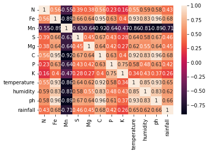
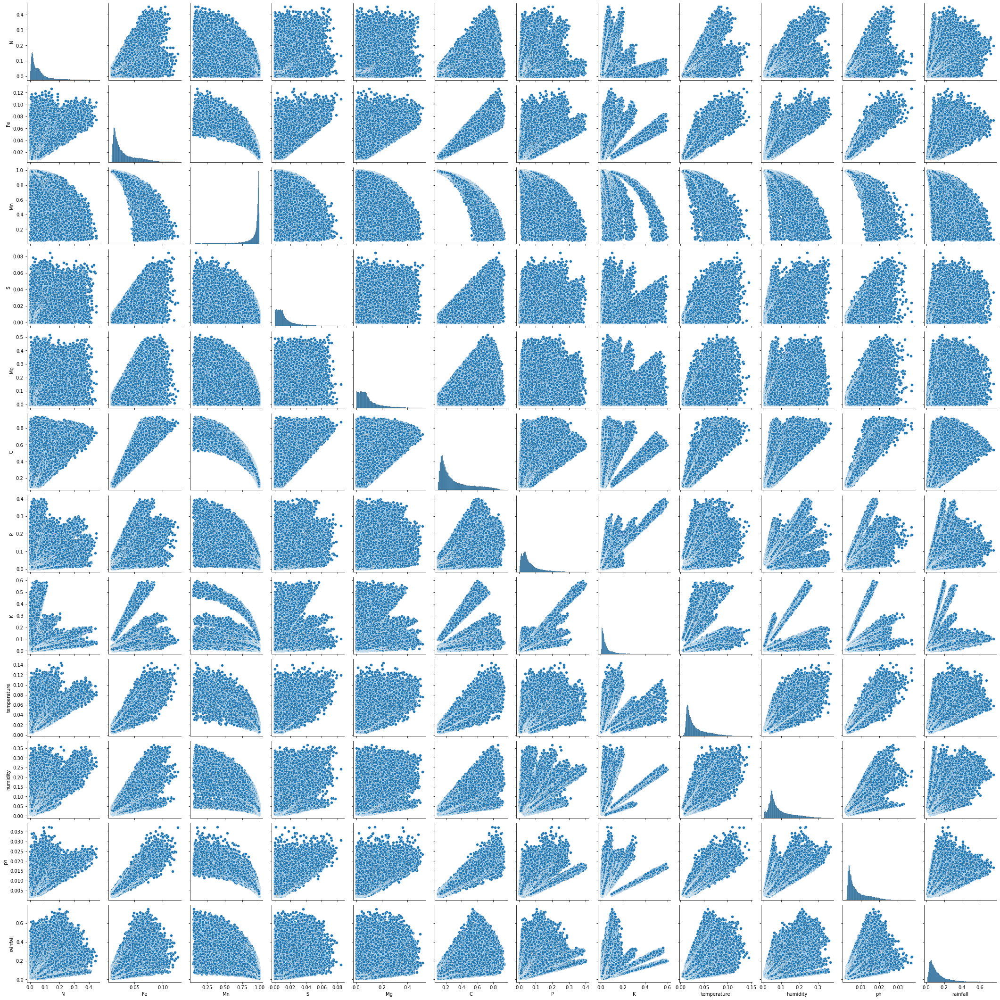
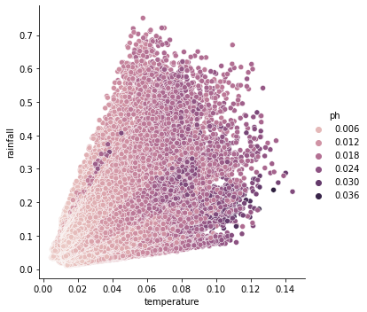
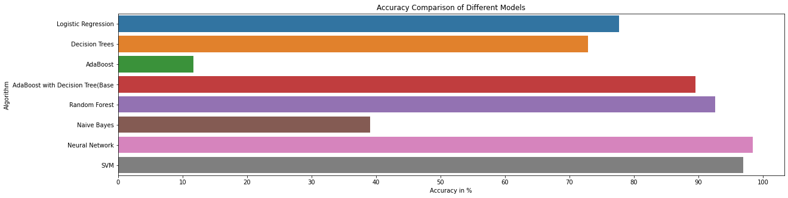

# Crop Recommendation System

## Fieldwise JavaScript app

Open `index.html` in a browser to use the warm, mobile-friendly crop finder. Enter your field's N, P, K, pH and seasonal weather readings to see the closest crop reference profiles. The optional trace-nutrient fields mirror the research notebook's inputs.

The notebook trains several classifiers on `crop_dataset.csv`, but that dataset is not included in this repository and the notebook does not save a deployable model. The interactive finder is therefore an explicitly labeled reference-profile preview, not a prediction from the notebook's trained model. Its match score is a profile similarity, not a probability or yield guarantee. To deploy the original trained model, supply the training dataset and export the selected classifier for JavaScript inference.

The supplied model-comparison chart is shown in the app under “The research behind the tool.”

---

## Introduction

This machine learning project’s objective is to find the best suitable crop for agricultural land by learning from the past yielded crops. Various factors are considered for determining the best yielding crop, such as the climate, which includes rainfall, temperature, and the soil contents such as the pH level, nutrient content such as N, P, K of the soil, and more. During this project, several machine learning algorithms are applied, and performance comparison is made between them.

## Features in dataset

The features for our model are:

- Rainfall in mm
- Temperature in Celsius
- Humidity
- pH level of soil
- Nitrogen (N) level of soil.
- Phosphorous (P) level of soil.
- Potassium (K) level of soil
- Iron (Fe) level in soil
- Calcium (Ca) level of soil
- Magnesium (Mg) level of soil
- Sulphur (S) level of soil
- Manganese (Mn) level of soil

---

### Corelation plot



### Pairgrid Plot



### Relational Plot



### Accuracy of different models



---

## Dataset

[Link Of Dataset](https://drive.google.com/file/d/1rnYMEN6y_2a86UGo4Hy9SZWICdOZkXVa/view?usp=sharing)

## Command to run code

```
jupyter notebook ML_final_code.ipynb
```

---

## Libraries used in project

- [Pandas](https://pandas.pydata.org/)
- [Numpy](https://numpy.org/)
- [Seaborn](https://seaborn.pydata.org/)
- [Matplotlib](https://matplotlib.org/)
- [Scikit-learn](https://scikit-learn.org/stable/index.html)

---
## This project is creacted with ❤️ by
- [Harsh Verma](https://github.com/Harsh3305/) 
- [Dhananjay Singh](https://github.com/Dhananjay19161)
- [Nitin Kumar Das](https://github.com/nitin23329)

---
## Connect with us

- [Github](https://github.com/Harsh3305/CropRecommendationSystem/)
